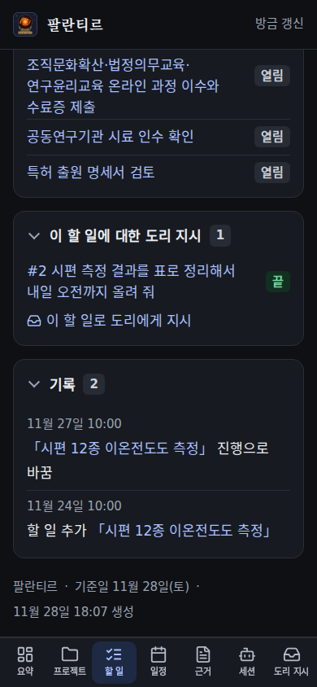
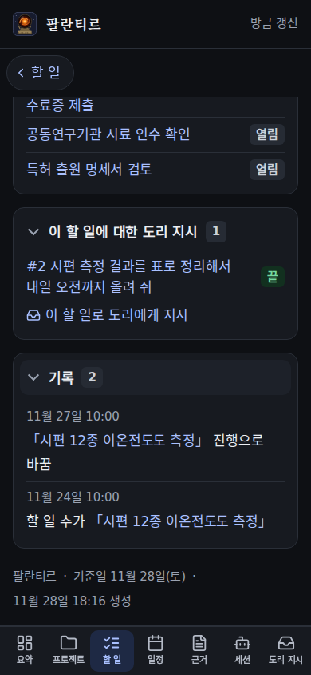
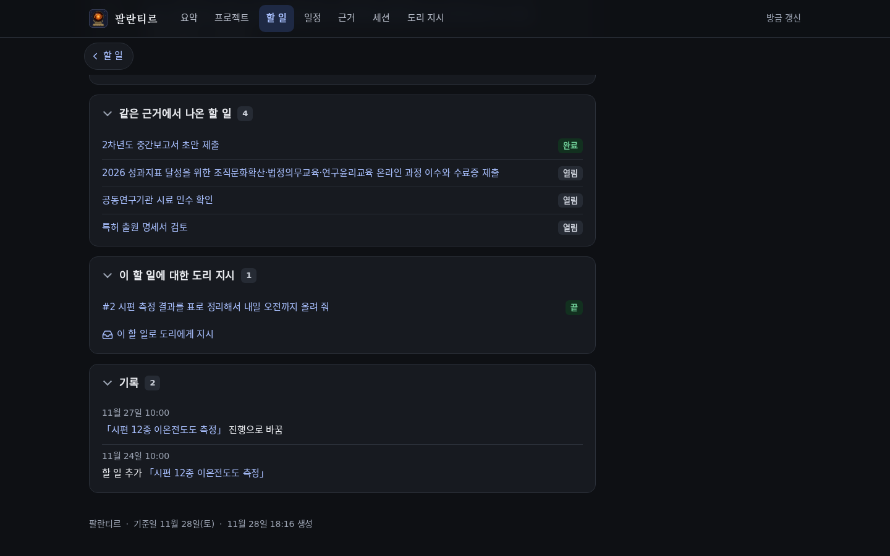
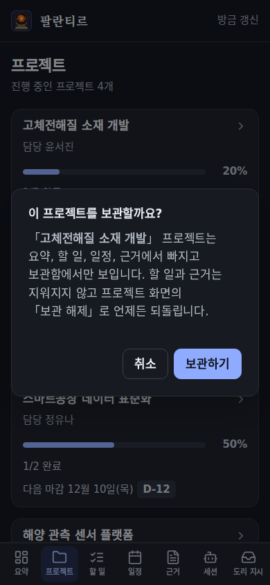
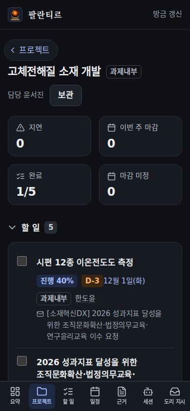

# 프로젝트 대시보드(팔란티르) — 뒤로 가기

## 무엇을
폰의 뒤로 가기(밀기·버튼)나 PC 브라우저의 뒤로를 누르면 바로 앞 화면(탭·열어 본 프로젝트·할 일·사람·지시·원문)으로 한 걸음씩 돌아간다.
상세 화면의 「‹ 앞 화면」 돌아가기 버튼은 머리 바로 아래에 붙어 있어 화면을 끝까지 내려도 늘 보인다. 보관 확인 창이 떠 있을 때 뒤로 가면 창만 닫힌다.

## 왜
형 2026-11-28 "팔란티르에 뒤로가기 기능 추가 해". 탭과 상세 화면은 이미 주소마다 한 걸음이었지만 두 군데가 걸렸다.
- 보관 확인 창을 띄운 채 폰에서 뒤로 밀면 창은 그대로 떠 있고 그 뒤 화면만 프로젝트 목록으로 바뀌었다. 창이 화면을 덮어 탭도 눌리지 않았다.
- 돌아가기 버튼이 화면 맨 위에만 있어, 긴 프로젝트·할 일·지시 화면을 내려 읽고 나면 버튼이 보이지 않았다.

## 사용 시나리오
- 폰 홈 화면의 팔란티르에서 할 일 → 일정 → 프로젝트 탭을 옮기고 프로젝트 하나, 그 안의 할 일, 담당자를 차례로 연다. 뒤로 밀 때마다
  담당자 → 할 일 → 프로젝트 → 프로젝트 탭 → 일정 → 할 일 → 요약 순으로 돌아가고, 탭 표시와 보던 스크롤 자리도 따라온다. 요약에서 한 번 더 밀면 팔란티르를 나간다.
- 긴 할 일 화면을 맨 아래 기록까지 내린 뒤에도 머리 아래의 「‹ 할 일」이 보이고, 누르면 연 화면의 그 자리로 돌아간다. 원문(근거 메일) 화면도 같다.
- 프로젝트 화면에서 「보관」을 눌러 확인 창이 뜬 채 뒤로 밀면 창만 닫히고 프로젝트 화면이 그대로 있다. 한 번 더 밀면 프로젝트 목록이다.
  창을 「취소」나 Esc로 닫아도 걸음이 남지 않아 다음 뒤로는 바로 프로젝트 목록이다. 「보관하기」를 누르면 보관함이 열리고 거기서 뒤로는 프로젝트 화면이다.
- 할 일·일정 탭에서 프로젝트를 고르면 그것도 한 걸음이라 뒤로 가면 전체 목록으로 돌아온다.
- 찾기 드롭다운의 펼친 목록은 걸음으로 치지 않는다(보통의 선택 상자처럼). 목록이 펼쳐진 채 뒤로 가면 앞 화면으로 간다.

| 전: 할 일 화면을 내리면 돌아가기가 사라짐 | 후: 머리 아래에 늘 보임 | 후(PC 1440) |
|---|---|---|
|  |  |  |

| 전: 확인 창이 뜬 채 뒤로 가면 창은 남고 뒤 화면만 바뀜 | 후: 창만 닫히고 프로젝트 화면이 그대로 |
|---|---|
|  |  |

캡처는 지어낸 데모 보드(`python3 -m automation.project_board demo`)다.

## 관련
- 화면: `automation/project_board/dashboard.py`(탭 스크립트의 주소 걸음, 보관 확인 창의 걸음), 테마 `dashboard_theme.py`(`.back` 붙박이)
- 규약: [프로젝트 대시보드 가이드](../guide/프로젝트-대시보드.md) 「누르면 그 정보로」. 승인·게이트 변화 없음(화면 이동만, 새 쓰기 경로 없음).
