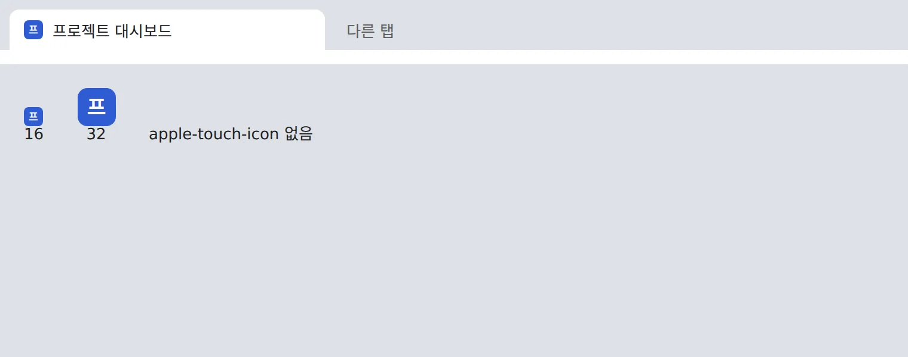
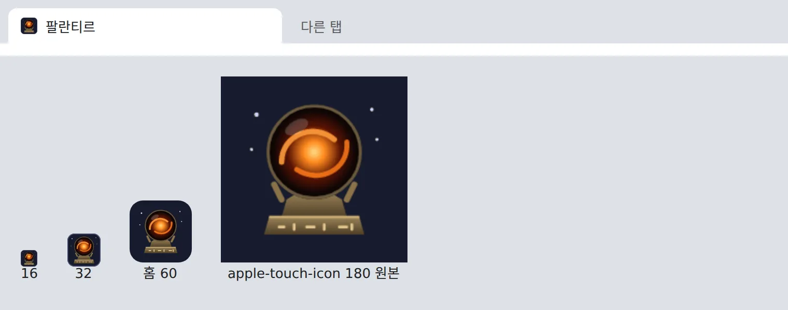

# 프로젝트 대시보드 — 팔란티르: 화면 이름과 그림 아이콘

## 무엇을
대시보드가 「팔란티르」라는 이름과 직접 그린 구슬 아이콘을 갖는다. 브라우저 탭, 화면 머리, 휴대폰 홈 화면에 같은 이름과 같은
그림이 뜬다. 아이콘은 반지의 제왕에 나올 법한 구슬이다 — 별이 뜬 밤하늘 돌 바탕 위, 룬 무늬를 새긴 낡은 청동 받침이 검은 유리
구슬을 받치고 그 안에서 주황 불꽃이 소용돌이친다. 머리의 이름 「팔란티르」는 세리프 글자로 쓴다.

## 왜
2026-10-31 소유자 지시: "프로젝트 대시보드 그것도 페이지 아이콘 만들어줘 그리고 프로젝트 대시보드 말고 좀 되게 발랄한 제목으로".
이전 아이콘은 이름 첫 글자 「프」를 파란 사각형에 쓴 것이라 탭에서 무엇인지 알아보기 어려웠고, 휴대폰 홈 화면에 추가하면
아이콘 없이 화면 캡처가 쓰였다. 이름 후보를 두 번 돌려 본 뒤 소유자가 Q402 "팔란티르 느낌나는 아이콘으로 하고 팔란티르로 하자"로 정했고, 파란 앱 아이콘 같은
첫 그림에는 "반지의 제왕에서 나올법한 테마로 해줘"라고 답해 지금 그림이 됐다.

## 전과 후 (지어낸 데모 데이터)
| 화면 | 전 | 후 |
|---|---|---|
| PC 탭 |  |  |
| 휴대폰(393) 머리 |  |  |
| 휴대폰(393) 머리 · 어둡게 | |  |

## 사용 시나리오
- 소유자가 PC 브라우저에 대시보드 탭을 여러 개 띄워 두어도 16px 탭에서 동그란 구슬이 보여 바로 찾는다. 탭 제목은 「팔란티르」다.
- 휴대폰 Safari 에서 「홈 화면에 추가」를 누르면 이름 칸에 「팔란티르」가, 아이콘 자리에 구슬 그림이 들어간다. 홈 화면에서 그 아이콘을
  누르면 추가한 그 대시보드 화면이 열린다.
- 다른 기관이 설치해 이름을 바꾸고 싶으면 설정 `{"dashboard": {"brand": "<이름>"}}` 을 둔다. 탭·머리·홈 화면 이름이 함께 바뀌고
  아이콘 그림은 그대로다.

## 관련
- `automation/project_board/dashboard_theme.py`(`icon_svg`·`head_icons`), `dashboard_icon_png.py`(홈 화면 180px PNG),
  `config.py`(`DEFAULT_BRAND`), `server.py`(CSP `manifest-src data:` — 그림과 이름은 페이지 안에 실려 오고 따로 받아 오는 것이 없다)
- 검증: `tests/unit/test_project_board_states.py`(그림·PNG·manifest·CSP), `automation/project_board/layout_audit.mjs`
- 규약: [프로젝트 대시보드 가이드](../guide/프로젝트-대시보드.md) 「4. 화면」의 「모양」. 승인·게이트 변화 없음(화면 이름과 그림만).
